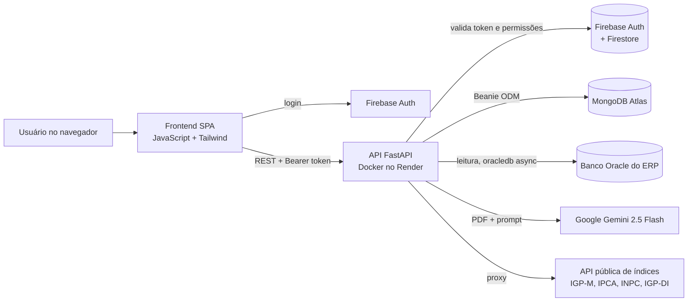

# Gestão de Contratos de Locação com IA

Sistema web que centraliza os contratos de aluguel das filiais de uma rede varejista. Ele lê o PDF do contrato com IA, calcula reajustes por índice econômico, acompanha os prazos de renovatória e concilia os pagamentos lançados no ERP.

> **Sobre este repositório:** o sistema foi desenvolvido para uso interno de uma empresa e o código-fonte é privado. Aqui ficam a arquitetura, as decisões técnicas e as telas, todas capturadas com dados fictícios. Apresento o código em entrevista, se for útil.

## O problema

Uma rede com dezenas de lojas alugadas acumula contratos em PDF, cada um com seu índice de reajuste, data de aniversário e prazo de renovação. Sem controle central, o reajuste vira conta manual, o prazo da ação renovatória (Lei 8.245/91, art. 51) corre sem alerta e os pagamentos registrados no ERP ficam desconectados do contrato que os originou.

## O que o sistema faz

- **Importação de contrato por IA.** O usuário envia o PDF e o modelo extrai locador, valor, vigência, índice, data de reajuste e dia de vencimento, além de gerar um resumo. O contrato entra no sistema já estruturado.
- **Renovação com herança de histórico.** Ao importar a renovação de um contrato, o novo documento herda a linha do tempo do anterior.
- **Reajustes.** Cálculo por IGP-M, IPCA, INPC ou IGP-DI em dois modos: reajuste do valor atual e correção do histórico desde o início do contrato, com a memória de cálculo de cada aniversário. O resultado pode ser aplicado ao contrato, com registro automático no histórico.
- **Painel de índices.** Variação mensal e acumulado de 12 meses dos quatro índices, obtidos de uma API pública por meio de um proxy no backend.
- **Extrato do contrato.** Linha do tempo com criação, reajustes, alterações, pagamentos e eventos manuais (renovatória, rescisão). Exclusões são lógicas, com motivo, autor e data; excluir um reajuste devolve ao aluguel o valor anterior.
- **Alertas de renovatória.** Contagem regressiva até a abertura do prazo de renovação e agrupamento dos contratos por filial, ano de vencimento ou ano de renovatória.
- **Conciliação com o ERP.** Consulta somente leitura ao banco Oracle do ERP para listar títulos de aluguel e notas com IR retido por período e locador. Os títulos selecionados são vinculados ao contrato e passam a aparecer no extrato.
- **Assistente de IA.** Chat que conhece a carteira de contratos, os índices e o histórico da conversa. Responde sobre vencimentos, valores e reajustes; quando a pergunta envolve cálculo, o backend faz a conta antes e o modelo só explica.
- **Administração.** Cadastro de filiais por empresa do grupo e troca da chave da IA pelo painel, sem reiniciar o servidor.

## Telas

<!--
Depois de capturar as telas com dados fictícios, salve as imagens em docs/img/
com os nomes abaixo e remova as linhas de comentário desta seção.

-->

*Todas as telas usam dados fictícios gerados para demonstração.*

## Arquitetura

Fluxos, modelo de dados e API detalhados em [docs/arquitetura.md](docs/arquitetura.md).

## Stack

- **Backend:** Python 3.11, FastAPI, Pydantic, Beanie (ODM assíncrono sobre Motor), httpx
- **Dados:** MongoDB Atlas; Oracle do ERP via python-oracledb assíncrono
- **IA:** Google Gemini 2.5 Flash pelo SDK google-genai
- **Autenticação:** Firebase Authentication (e-mail/senha e Google) e Firestore para listas de acesso
- **Frontend:** JavaScript com ES Modules, sem framework, Tailwind CSS e DOMPurify
- **Infra:** Docker (python:3.11-slim) no Render

## Destaques técnicos

**A IA conversa, o Python calcula.** Modelos de linguagem erram aritmética com frequência. Quando a pergunta ao assistente pede um reajuste, o backend detecta a intenção, calcula o valor com a série histórica do índice e injeta o resultado, com o passo a passo, no prompt. O modelo apenas redige a resposta.

**Extração estruturada de PDF.** O PDF vai inteiro para o modelo, que devolve JSON. Como a saída de um LLM nem sempre é JSON válido, a API isola o objeto, corrige quebras de linha e vírgulas ausentes e normaliza valores no formato brasileiro ("1.234,56") e datas antes de gravar.

**Regra de reajuste explícita e auditável.** O reajuste ocorre no aniversário do contrato e usa o índice acumulado nos 12 meses encerrados no mês anterior. Índice negativo ou zero mantém o valor. Cada aniversário gera uma linha de memória de cálculo.

**Histórico como trilha de auditoria.** O histórico fica aninhado no documento do contrato. Nenhum evento é apagado de fato: a exclusão registra motivo, autor e data, e excluir um reajuste reverte o aluguel ao valor anterior. A primeira versão usava PostgreSQL com SQLAlchemy; a atual usa MongoDB com Beanie, e contrato e histórico viraram um único documento.

**Segurança em camadas.** O backend valida o token do Firebase com checagem de revogação e, em seguida, exige e-mail verificado, domínio corporativo, presença em uma lista de acesso no Firestore e perfil de administrador para as rotas sensíveis. O frontend encerra a sessão após 10 minutos de inatividade (exceto durante um upload) e sanitiza a saída do chat com DOMPurify. O acesso ao ERP é somente leitura, com bind variables.

**Configuração da IA a quente.** A chave do Gemini pode ser trocada pelo painel. O valor gravado no banco tem precedência sobre a variável de ambiente, e o cliente é recriado sob um lock assíncrono, sem reiniciar o servidor.

## Próximos passos

- Testes automatizados para a regra de reajuste e para a extração de PDF
- Mover os PDFs, hoje em base64 dentro do documento, para armazenamento de objetos
- Concluir o módulo financeiro, ainda em construção

## Autor

Lucas Anacleto Fassolo · [github.com/FassoloLucas](https://github.com/FassoloLucas)

Este repositório contém apenas documentação. O código do sistema não é distribuído.
