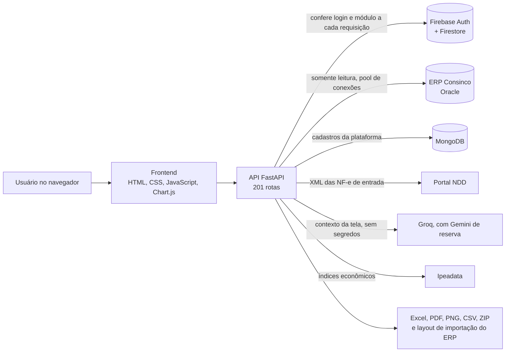

# Plataforma de Gestão Contábil e Fiscal

Plataforma web interna que reúne, em um só lugar, as consultas, os relatórios e as conferências das áreas de **Contratos, Comercial, Financeiro, Contabilidade, Fiscal e Orçamento** de uma rede varejista. Ela lê os dados direto do ERP (TOTVS Consinco, em Oracle), aplica as regras contábeis e fiscais de cada rotina e entrega o resultado pronto na tela, em Excel, PDF ou ZIP. Uma assistente de IA responde perguntas sobre o que está na tela, dentro das permissões de quem pergunta.

> **Sobre este repositório:** a plataforma foi criada para uso interno de uma empresa e o código-fonte é privado. Aqui ficam a visão do produto, a arquitetura, as regras de negócio e as telas, todas capturadas com dados fictícios. Apresento o código em entrevista, se for útil.

## Em números

- 6 módulos de negócio e um de administração
- Mais de 55 telas e 201 rotas de API
- 1.058 testes de backend em 60 arquivos e 367 testes de frontend, todos passando
- 86 versões entregues entre agosto e outubro de 2026, com a plataforma em uso
- Projetada e desenvolvida por uma pessoa, do backend às regras contábeis

## O problema

Relatórios como DRE, livro razão, consumo e notas de orçamento eram montados à mão a partir de extrações do ERP. Cada pessoa aplicava os critérios do seu jeito (sinal da DRE, lançamento de encerramento, data de corte), a conferência das notas de entrada era feita por amostragem e controles como arrendamento, depreciação e DRE por loja viviam em planilhas soltas. A plataforma substitui esse trabalho por regras escritas uma vez e aplicadas sempre do mesmo jeito.

## Módulos

- **Contratos.** Contratos de aluguel das lojas: importação do PDF com leitura por IA, reajuste por IGP-M, IPCA, INPC ou IGP-DI, alertas de renovatória, linha do tempo auditável e vínculo dos títulos pagos no ERP.
- **Comercial.** Acordos com fornecedores, indicadores, inadimplência com justificativa por título e análises de conformidade das baixas com IA.
- **Financeiro.** Tarifas bancárias, fluxo de caixa do fundo fixo, conciliação pedido a pedido com o iFood e cancelamentos de itens no PDV.
- **Contabilidade.** Consumo, notas de orçamento, agenda de obrigações, calculadora de tributos por regime, livro razão, sete páginas de DRE (inclusive por loja), arrendamento pelo CPC 06 e controle de depreciação com fechamento por competência.
- **Fiscal.** Conferência item a item do XML das NF-e de entrada contra o lançamento no ERP, painel e download em lote do portal NDD, F100 da EFD-Contribuições, FCP, DIFAL, emissões canceladas e inutilizadas, documentos por CGO, extrator de XML e resumo do SPED.
- **Orçamento.** Orçamento anual por setor contra o consumo contábil real, com projeção do ano, manutenção do vínculo conta → setor e links de consulta por setor.
- **Administração.** Usuários e módulos liberados, configuração da IA e monitor de uso.

Detalhes de cada tela em [docs/modulos.md](docs/modulos.md).

## Telas

<!--
Depois de capturar as telas com dados fictícios, salve as imagens em docs/img/
com os nomes abaixo e remova as linhas de comentário desta seção.

-->

*Todas as telas usam dados fictícios gerados para demonstração.*

## Arquitetura

Componentes, fluxos, segurança e desempenho em [docs/arquitetura.md](docs/arquitetura.md).

## Destaques

**Regras contábeis escritas no código.** O lançamento de encerramento de 31/12 sai da DRE e do Orçamento e fica no Livro Razão. A DRE usa crédito menos débito, para que variação positiva seja sempre melhora; o razão usa débito menos crédito com natureza D/C. A cobertura documental das despesas é medida contra o débito da conta, porque rateios e estornos reduzem o saldo e inflariam o percentual. Todas as regras estão em [docs/regras-contabeis-e-fiscais.md](docs/regras-contabeis-e-fiscais.md).

**Conferência fiscal que entende o documento.** A comparação XML × ERP soma o FCP ao ICMS antes de comparar, converte unidade comercial em tributável, calcula em decimal com tolerância de R$ 0,02 e ignora diferença de PIS/COFINS quando o CST não gera crédito. Dado ausente vira "dados incompletos" e fica fora da contagem de divergências.

**CPC 06 e depreciação que fecham no centavo.** No arrendamento, o arredondamento é feito nos saldos acumulados, para que cada mês fique a até um centavo do valor exato e os saldos zerem no fim do contrato. Na depreciação, o último mês lança o residual e a conciliação com o saldo do ERP não tem tolerância. Competências fechadas bloqueiam eventos retroativos até serem reabertas.

**IA com escopo controlado.** A assistente recebe apenas o contexto resumido da tela aberta, descarta campos que pareçam senha, token ou chave e responde só sobre módulos que o usuário pode ver. No módulo de contratos, quando a pergunta pede um reajuste, o backend faz a conta e o modelo só explica. O provedor principal é o Groq, com o Gemini como reserva.

**Desempenho medido.** O PDF do livro razão foi reescrito: 2.172 lançamentos saem em menos de 1 segundo, contra 45 segundos antes. O resumo do SPED lê cerca de 340 MB no próprio navegador em cerca de 9 segundos, sem ocupar o servidor. Consultas pesadas ao Oracle têm teto de 60 segundos e são divididas por filial quando o volume exige.

**Segurança por módulo.** Toda rota confere a permissão do módulo; login, situação e permissões são reavaliados a cada requisição, então bloquear um usuário encerra as sessões dele na hora. O ERP é acessado só para leitura e uploads têm limite de tamanho e verificação antes da leitura.

## Stack

- **Backend:** Python, FastAPI, pandas, python-oracledb, Beanie/MongoDB
- **Relatórios:** openpyxl, XlsxWriter, WeasyPrint, ReportLab
- **Frontend:** HTML, CSS e JavaScript sem framework, Chart.js
- **Autenticação:** Firebase Authentication e Firestore
- **IA:** Groq e Google Gemini
- **Integrações:** ERP TOTVS Consinco (Oracle), portal NDD de NF-e, Ipeadata
- **Testes:** 1.058 testes de backend e 367 de frontend, sem tocar nos bancos de produção

## Linha do tempo

- **Jan/2026:** concepção e primeiro módulo (contratos de aluguel com IA)
- **Ago/2026:** histórico de versões começa com a plataforma em uso; DRE
- **Set/2026:** livro razão, módulo fiscal com conferência XML e integração NDD, orçamento, FCP e DIFAL, análise de despesas, arrendamento e depreciação
- **Out/2026:** emissões canceladas, resumo do SPED, links de orçamento por setor, revisão de segurança, DRE por loja e consulta de fornecedores

## Autor

Lucas Anacleto Fassolo, especialista contábil e desenvolvedor · [github.com/FassoloLucas](https://github.com/FassoloLucas)

© 2026 Lucas Fassolo. Todos os direitos reservados. Este repositório contém apenas documentação demonstrativa de portfólio; a reprodução do texto, arquitetura ou imagens sem autorização é proibida.
