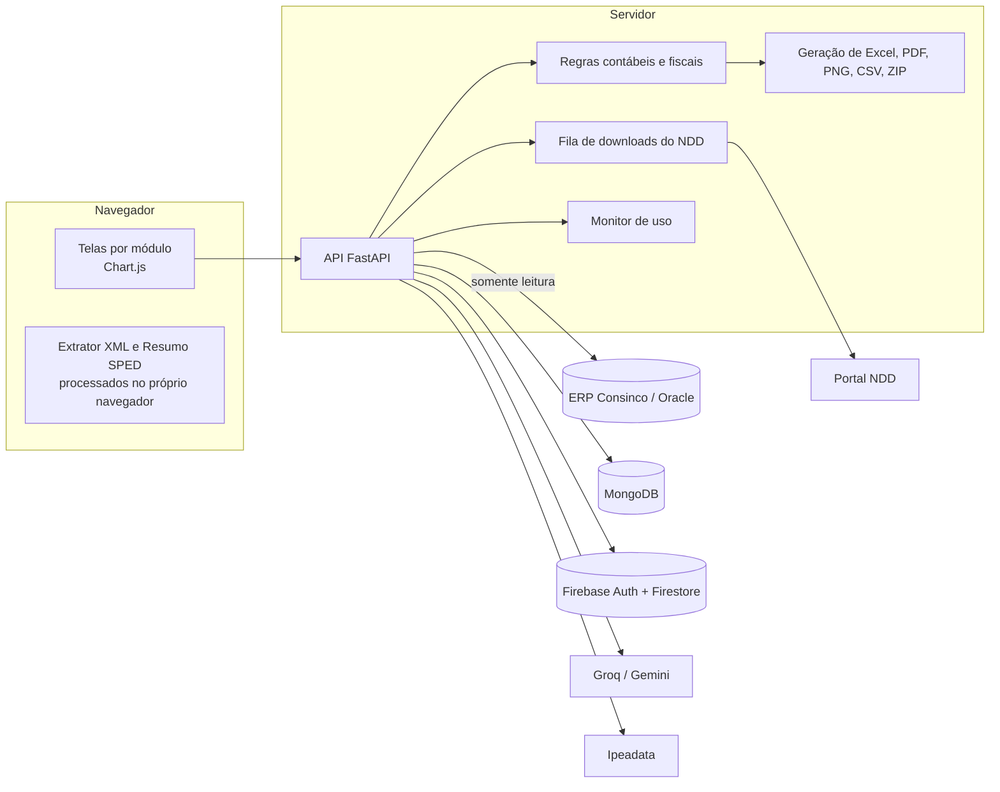
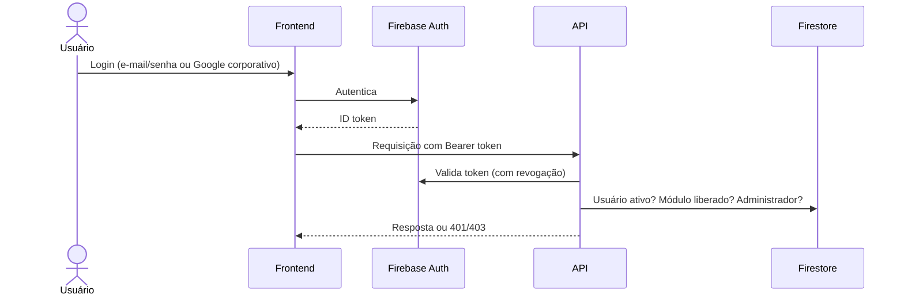
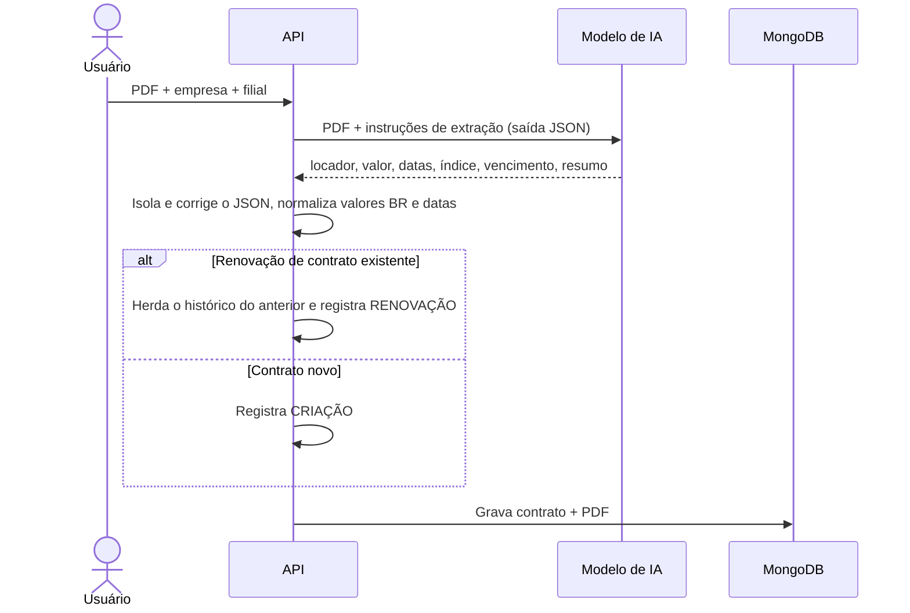

# Arquitetura

## Visão geral

O usuário abre a plataforma no navegador, sem instalar nada. A tela conversa com uma API FastAPI, que confere quem está pedindo, busca os dados nas fontes, aplica as regras e devolve o resultado para a tela ou como arquivo. O mesmo servidor entrega o frontend estático.



## Fontes de dados

- **ERP (Oracle):** saldos e lançamentos contábeis, plano de contas, notas fiscais, títulos a pagar e a receber, acordos e cadastros. Acesso somente leitura; a plataforma não grava nada no ERP.
- **MongoDB:** o que é da própria plataforma: contratos e PDFs, pagamentos vinculados, orçamento e vínculo conta → setor, contratos e fechamentos do arrendamento, bens e competências da depreciação, aluguel fixo e observações da DRE por loja, agenda de obrigações, empresas fiscais e apurações, CMV gerencial, justificativas de inadimplência, configurações de IA e histórico do monitor.
- **Firebase:** contas de acesso, situação (ativa ou bloqueada) e módulos liberados, conferidos a cada requisição.
- **Portal NDD:** catálogo e XML autorizado das NF-e de entrada. XMLs e listagens baixados ficam guardados no servidor e são reaproveitados por todos.
- **Groq e Gemini:** respostas da assistente, leitura de contratos em PDF e análises em texto. Recebem só o contexto da tela, com dados sensíveis filtrados.
- **Ipeadata:** séries de IGP-M, IPCA, INPC e IGP-DI para os reajustes.
- **Arquivos do usuário:** XML, ZIP e o .txt do SPED, lidos no navegador pelo Extrator XML e pelo Resumo SPED, sem envio ao servidor.

## Saídas

- **Excel:** consumo, notas de orçamento, tarifas, inadimplência, DRE, DRE por loja, arrendamento, depreciação, conferência XML, FCP, emissões canceladas, fornecedores, extrator XML e conciliação iFood.
- **Layout de importação do ERP:** lançamentos da depreciação e reclassificação do imobilizado.
- **PDF:** DRE, dashboard da DRE, livro razão, tarifas e dashboard comercial.
- **PNG:** blocos do dashboard da DRE para apresentações.
- **CSV e ZIP:** itens do DIFAL, XMLs do NDD em lote e o pacote da conciliação iFood.

## Segurança



- Login só com e-mail do domínio corporativo e endereço verificado.
- Toda rota confere a permissão do módulo. Login e permissões são reavaliados a cada requisição: uma mudança de acesso vale na requisição seguinte e bloquear um usuário encerra as sessões dele.
- Perfis: usuário (consulta e exporta os módulos liberados), administrador (escrita administrativa, fechamento de competências, usuários) e link de setor (só o painel de orçamento daquele setor e ano, revogável).
- Senhas e chaves ficam no servidor; a tela de IA mostra só se a chave está configurada.
- A assistente descarta campos que pareçam senha, token ou chave antes de enviar o contexto ao modelo.
- Uploads com limite de tamanho e verificação antes da leitura.
- Sessão encerrada após 30 minutos sem atividade, exceto durante o envio de arquivo.
- O monitor registra quem acessou o quê, quando, quanto tempo levou e se deu certo, sem guardar os filtros usados, por 7 dias.

## Desempenho

- Consultas ao Oracle têm teto de 60 segundos. Quando o volume exige, a consulta é dividida (uma filial por vez no FCP e no DIFAL) ou guardada em cache por tempo definido (DRE, DRE por loja, orçamento, análise de despesas, dashboard comercial e plano de contas). No orçamento, o ano corrente fica 10 minutos em cache e anos anteriores, 1 hora.
- Excel, PDF e chamadas de IA rodam em paralelo, sem travar os outros usuários, com pool de até 40 conexões ao Oracle.
- O livro razão pagina na própria consulta (200 lançamentos por página). O PDF foi reescrito: 2.172 lançamentos em menos de 1 segundo, contra 45 segundos antes.
- Exportações grandes têm limite de segurança: o PDF do razão recusa mais de 200 mil lançamentos e a visão analítica de fornecedores para em 50 mil itens.
- O Extrator XML e o Resumo SPED leem os arquivos no navegador: cerca de 340 MB de SPED em cerca de 9 segundos, sem ocupar o servidor.
- Downloads do NDD: cada pessoa tem sua tarefa, até 10 usam o portal ao mesmo tempo e as demais aguardam na fila, com limite global de 8 requisições por segundo.

## Exemplo de fluxo: importação de contrato por IA



Regra de reajuste usada nos contratos:

```
para cada aniversário do contrato até hoje:
    índice = acumulado de 12 meses encerrado no mês anterior ao aniversário
    se índice > 0:
        valor = arredondar(valor × (1 + índice / 100), 2)
    registrar a linha da memória de cálculo
```

## Qualidade

- 1.058 testes de backend em 60 arquivos, cobrindo DRE, DRE por loja, orçamento, livro razão, arrendamento, depreciação, conferência fiscal, NDD, F100, FCP, DIFAL, emissões canceladas, fornecedores, autenticação, usuários, segurança, monitor e assistente. Rodam sem tocar nos bancos de produção.
- 367 testes de frontend cobrindo cálculos, filtros, estado da tela e exportações.
- Valores conferidos contra fontes oficiais: consumo do orçamento contra o balancete, FCP e DIFAL contra a apuração, resumo do SPED contra o E110.
- Documentação técnica interna com arquitetura, instalação e operação, manual das telas, regras de cada módulo, integrações fiscais, segurança, referência de API e modelos de dados.

## Stack

Python, FastAPI, pandas, python-oracledb, Beanie/MongoDB, openpyxl, XlsxWriter, WeasyPrint, ReportLab, Firebase Authentication e Firestore, Groq, Google Gemini, HTML, CSS, JavaScript e Chart.js.
