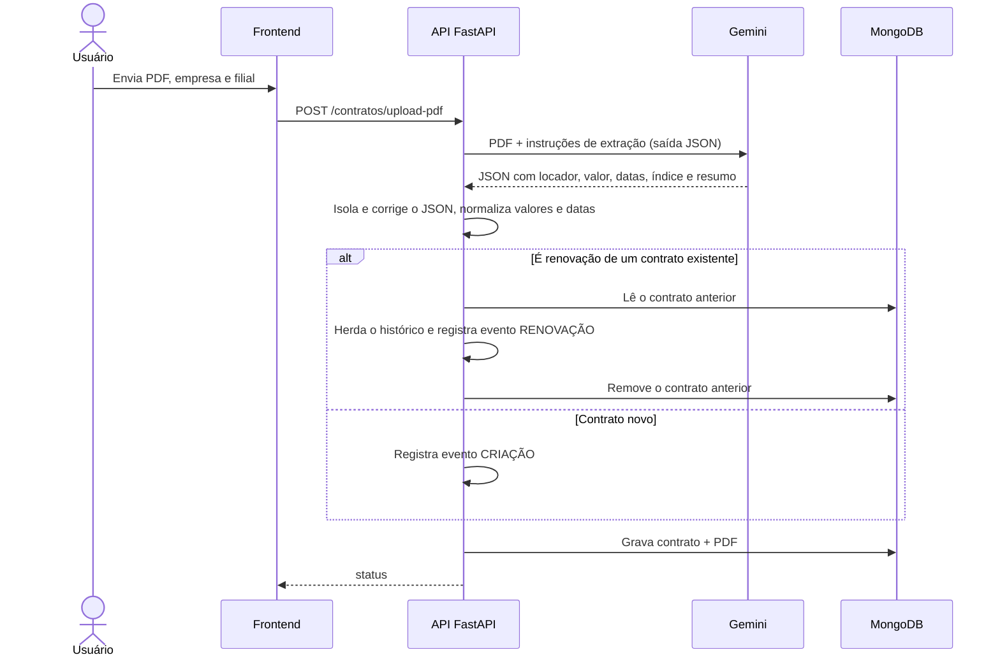
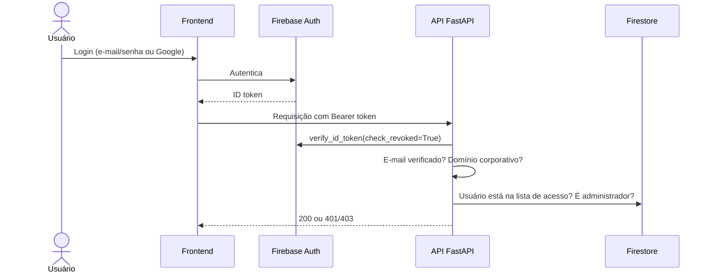
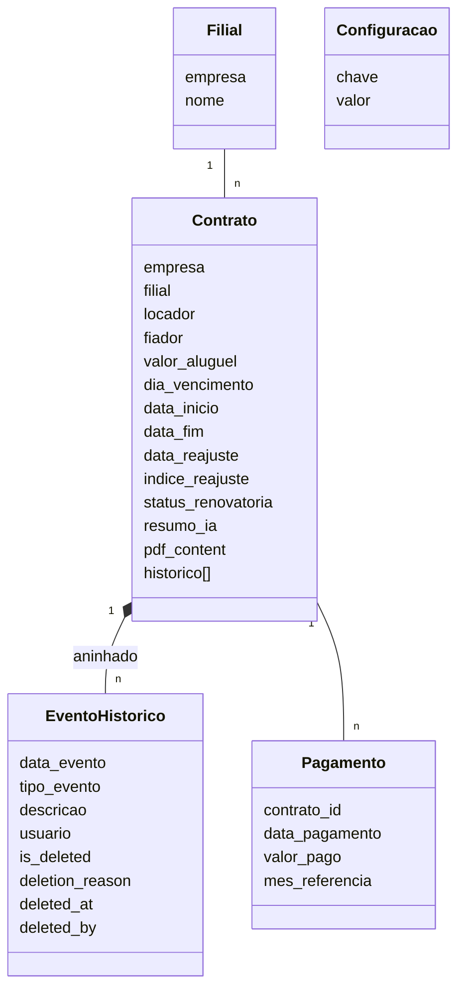

# Arquitetura

## Visão geral

O backend é uma API FastAPI que também serve o frontend estático. O frontend é uma SPA em JavaScript puro, organizada em componentes que devolvem HTML (dashboard, extrato, reajustes, filiais, importação, assistente, administração). Todo pedido à API carrega o ID token do Firebase no cabeçalho `Authorization`.

| Camada | Responsabilidade |
| --- | --- |
| Frontend | Estado da aplicação, renderização dos módulos, tema claro/escuro, logout por inatividade |
| API FastAPI | Regras de negócio, cálculo de reajuste, orquestração da IA, autorização |
| MongoDB (Beanie) | Contratos com histórico aninhado, filiais, pagamentos, configurações |
| Oracle do ERP | Fonte somente leitura de títulos e notas de despesa |
| Gemini | Extração de dados do PDF e respostas do assistente |
| Firebase | Autenticação e listas de acesso |

## Importação de contrato



## Autenticação e autorização



## Assistente de IA

A cada pergunta, a API monta um contexto com a data de hoje, as últimas mensagens da conversa, as filiais, um dossiê de cada contrato (dados principais, resumo do PDF e últimos eventos do histórico) e as séries dos índices enviadas pelo frontend. Se a pergunta pede reajuste de um contrato, o cálculo é feito em Python antes da chamada ao modelo e entra no prompt como dado pronto, com a memória de cálculo. O frontend exibe uma mensagem de espera conforme a intenção detectada e sanitiza a resposta antes de renderizar.

## Regra de reajuste

```
para cada aniversário do contrato até hoje:
    índice = acumulado de 12 meses encerrado no mês anterior ao aniversário
    se índice > 0:
        valor = arredondar(valor × (1 + índice / 100), 2)
    registrar a linha da memória de cálculo
```

O modo "reajustar valor atual" aplica um único índice a um valor informado. Aplicar o resultado ao contrato gera um evento REAJUSTE com o índice usado; excluir esse evento restaura o valor anterior.

## Modelo de dados



Tipos de evento: CRIAÇÃO, RENOVAÇÃO, REAJUSTE, ALTERAÇÃO MANUAL, AJUSTE MANUAL, ALTERAÇÃO, PAGAMENTO, PAGAMENTO_ERP, VINCULACAO_ERP e eventos manuais (renovatória, rescisão, outros).

## API

Todas as rotas exigem autenticação.

**Contratos**

- `GET /contratos/` lista contratos
- `GET /contratos/{id}` detalhe com histórico e pagamentos
- `PATCH /contratos/{id}` atualização parcial com registro automático no histórico
- `DELETE /contratos/{id}` exclusão
- `POST /contratos/upload-pdf` importação por IA, inclusive renovação
- `POST /contratos/contratos/{id}/replace-pdf` troca o PDF e reextrai os dados
- `POST /contratos/historico/manual` evento manual
- `POST /contratos/historico/{id}/soft-delete` exclusão lógica de evento
- `POST /contratos/calcular-reajuste` correção desde o início do contrato
- `POST /contratos/reajustar-valor-atual` reajuste de um valor informado
- `GET /contratos/indices-proxy` séries de índices econômicos
- `POST /contratos/chat` assistente de IA
- `GET|POST|DELETE /contratos/filiais` cadastro de filiais

**Pagamentos**

- `POST /pagamentos/{contrato_id}` registra pagamento
- `DELETE /pagamentos/{id}` remove pagamento
- `GET /pagamentos/locadores` locadores com títulos de aluguel quitados no período (ERP)
- `GET /pagamentos/consulta-pagamentos-aluguel` notas com IR retido por período e locador (ERP)
- `POST /pagamentos/vincular-a-contrato` vincula títulos do ERP ao contrato

## Deploy

A imagem Docker parte de `python:3.11-slim`, instala as dependências e sobe o Uvicorn na porta 8000. O Render executa o container e injeta as variáveis de ambiente (MongoDB, Oracle, Gemini e credenciais do Firebase em JSON). Em desenvolvimento, as mesmas variáveis vêm de um arquivo `.env` fora do controle de versão.
